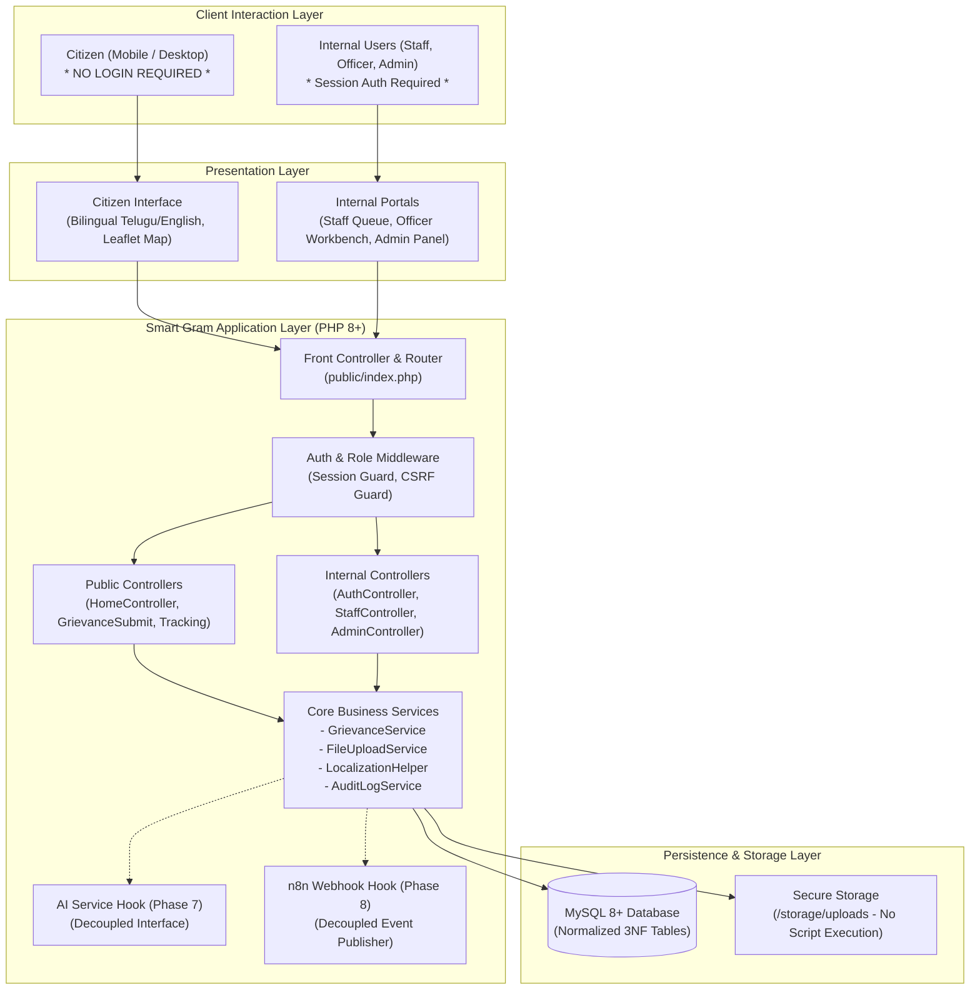
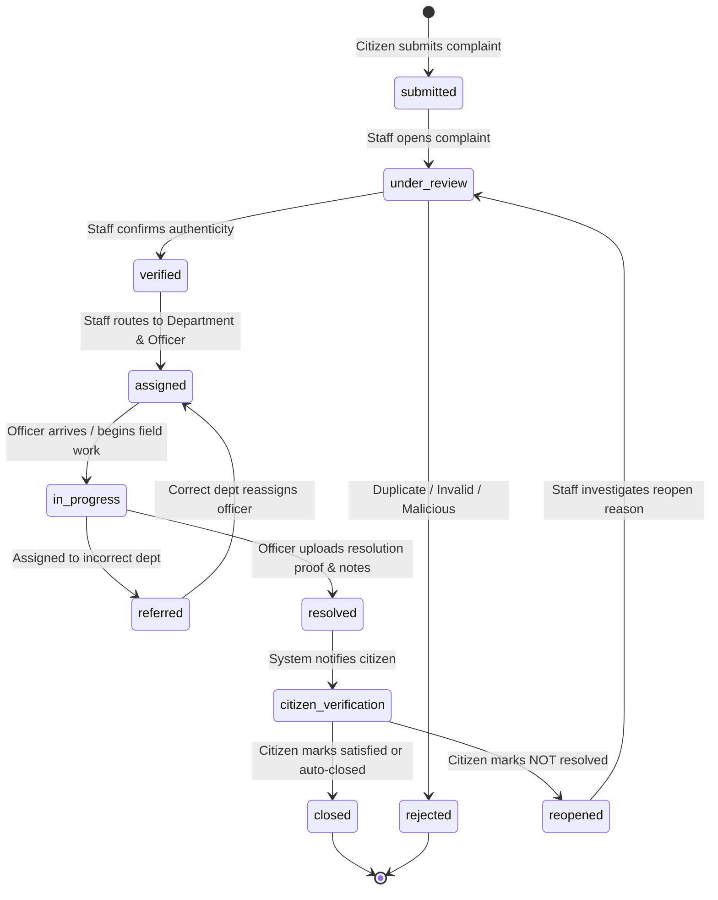
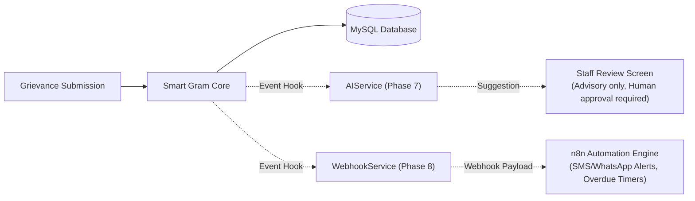
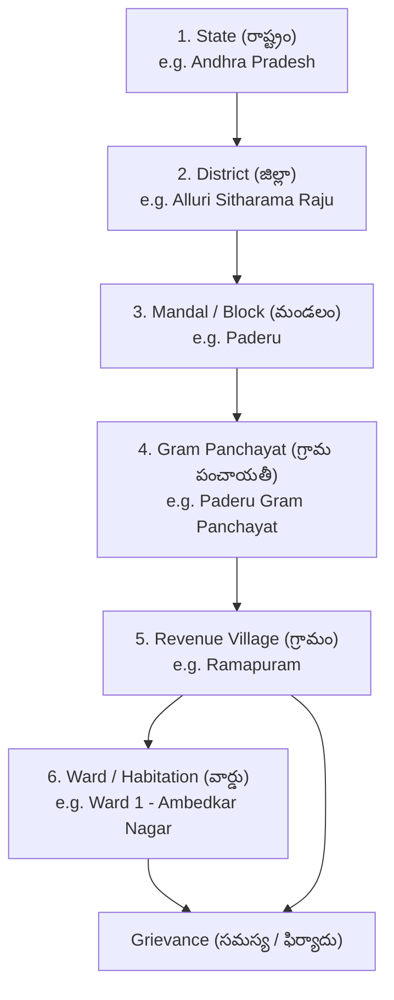

# Smart Gram — System Architecture Specification
**Document Version:** 1.0  
**Phase:** Phase 0 (Architecture & Planning)

---

## 1. High-Level Architectural Diagram

Smart Gram follows a clean, decoupled MVC (Model-View-Controller) / Service-oriented architecture built with PHP 8+ and MySQL 8+.



---

## 2. Key Architectural Pillars

### 2.1 Citizen-First & Frictionless (NO LOGIN)
- In rural governance, mandatory account creation creates immense drop-off due to forgotten passwords, complex registration forms, and lack of email addresses.
- **Workflow:**
  1. Open website (Telugu by default).
  2. Select Village, Ward, and Problem Category.
  3. Enter simple description, optional photo proof, and landmark.
  4. Submit and immediately receive a unique Grievance Tracking Number (e.g. `GRV-2026-00001`).
  5. Check grievance status anytime using Grievance ID + registered Phone Number.
  6. Rate resolution or reopen grievance if unresolved.

### 2.2 Bilingual Translation Engine (Telugu & English)
Translations are decoupled from view markup and stored in structured dictionary arrays:
- `lang/te/citizen.php`, `lang/te/status.php`, `lang/te/common.php`
- `lang/en/citizen.php`, `lang/en/status.php`, `lang/en/common.php`

**Helper syntax:**
```php
__('citizen.submit_button'); 
// In Telugu: "సమస్యను పంపండి"
// In English: "Submit Grievance"
```
The active language is stored in session/cookies with an instant URL switch: `?lang=te` or `?lang=en`.

---

## 3. Grievance Status State Machine

The complaint resolution process follows a strict state transition model:



### Transition Integrity Rules:
1. **Audit Traceability:** Every change writes an immutable record into `grievance_updates` (`user_id`, `from_status`, `to_status`, `remarks`, `timestamp`).
2. **Referral Preservation:** If referred between departments (e.g. from Sanitation to Water Supply), the grievance preserves its original ID, timeline, and photo history.
3. **Mandatory Proof of Work:** Changing status to `resolved` strictly requires resolution remarks and photographic evidence uploaded to `attachments`.

---

## 4. Security Architecture

1. **Database Access:** 100% prepared statements via PHP Data Objects (`PDO`). String concatenation in SQL statements is strictly prohibited.
2. **Authentication (Internal Only):** 
   - Passwords hashed using `password_hash($password, PASSWORD_BCRYPT)` or `PASSWORD_ARGON2ID`.
   - Session identifiers regenerated (`session_regenerate_id(true)`) upon login.
   - HttpOnly and SameSite cookie flags enabled.
3. **Cross-Site Request Forgery (CSRF):** Unique cryptographic tokens generated per session and validated on all POST/PUT/DELETE actions.
4. **File Upload Security:**
   - Whitelist validation: `image/jpeg`, `image/png`, `image/webp` only.
   - Files renamed to cryptographically random SHA-256 hashes.
   - Stored in `/storage/uploads/` outside the web root or guarded with `.htaccess` (`php_flag engine off`).
5. **Output Escaping:** All user-supplied data rendered into HTML is sanitized via `htmlspecialchars($string, ENT_QUOTES, 'UTF-8')`.

---

## 5. Decoupled AI & Automation Design

To ensure reliability, the core application has zero hard dependencies on external network services:


- **If AI is down:** Staff manually select Category, Department, and Priority as usual.
- **If n8n is down:** Citizen submissions, officer updates, and database transactions continue without interruption.

---

## 6. Administrative Geographic Hierarchy (6-Tier Architecture)

Smart Gram supports a generalized, non-hardcoded 6-tier administrative hierarchy designed for pan-state and pan-district scalability:



### Architectural Principles:
1. **Zero Hardcoded Geography:** No district, mandal, or village names are hardcoded in application logic, SQL queries, or frontend JavaScript. All dropdowns and cascades dynamically query the relational schema.
2. **Self-Resolving Cascades:** `Location::resolveHierarchy(villageId)` and `GrievanceService::submitGrievance()` automatically resolve parent IDs (`state_id`, `district_id`, `mandal_id`, `gram_panchayat_id`) upward through foreign keys.
3. **Multi-Jurisdiction Extensibility:** Seamlessly hosts multiple states, multiple districts, multiple mandals, and multiple panchayats concurrently on a single unified instance.

---

## 7. Location-Scoped Role-Based Access Control (RBAC)

Smart Gram enforces granular geographic jurisdiction boundaries on top of role permissions:

### 7.1 Access Matrix by Role & Scope

| Role | Geographic Scope (`location_scope`) | Operational Permissions | Scope Boundary Enforcement |
| :--- | :--- | :--- | :--- |
| **Admin** | `state` / Global | Unrestricted system-wide management | Full visibility across all districts, mandals, and panchayats |
| **Panchayat Staff** | `gram_panchayat` or `village` | Verify complaints, assign field officers, reject/refer | Strictly bounded to assigned Gram Panchayat / Village. Cannot view or mutate grievances in foreign panchayats. |
| **Field Officer** | `mandal`, `district`, or `village` | Start field work, log progress notes, upload photo resolution evidence | Bounded to grievances in their assigned department AND assigned geographic jurisdiction. Direct assignment permits cross-boundary execution. |

### 7.2 Core Enforcement Methods:
- **`User::canAccessGrievance(array $user, array $grievance): bool`**: Validates role, department, and hierarchical geographic containment (`state`, `district`, `mandal`, `gram_panchayat`, `village`).
- **`User::getGeographicScopeFilters(array $user): array`**: Generates mandatory SQL filter constraints injected into dashboard queues, KPI analytics, and CSV exports to prevent data leaks.
- **`Grievance::getEligibleOfficers(?int $deptId, ?int $villageId, ?array $geoScope): array`**: Automatically resolves the complaint's parent hierarchy and returns only field officers whose jurisdiction encompasses that location.
- **`User::getScopeBadge(array $user, string $lang): string`**: Renders bilingual, human-friendly jurisdiction badges across dashboards and report headers.
