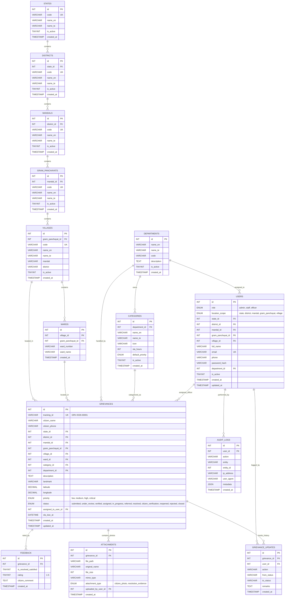

# Smart Gram — Database Schema Specification
**Document Version:** 1.0  
**Target Engine:** MySQL 8.0+ / MariaDB 10.5+  
**Default Collation:** `utf8mb4_unicode_ci` (Full Unicode & Telugu support)

---

## 1. Entity-Relationship Diagram (ERD)

---

## 2. Administrative Geographic Hierarchy (6-Tier)

Smart Gram uses a fully relational, scalable 6-tier administrative hierarchy with zero hardcoding:

### 2.1 Hierarchy Tables:
1. **`states`**: Top-level state administrative entity (e.g., Andhra Pradesh / ఆంధ్రప్రదేశ్).
2. **`districts`**: Belongs to `states` via `state_id` (e.g., Alluri Sitharama Raju / అల్లూరి సీతారామరాజు).
3. **`mandals`**: Belongs to `districts` via `district_id` (e.g., Paderu / పాడేరు).
4. **`gram_panchayats`**: Belongs to `mandals` via `mandal_id` (e.g., Paderu GP / పాడేరు గ్రామ పంచాయతీ).
5. **`villages`**: Belongs to `gram_panchayats` via `gram_panchayat_id` (e.g., Ramapuram / రామాపురం).
6. **`wards`**: Belongs to `villages` via `village_id` and `gram_panchayats` via `gram_panchayat_id`.

### 2.2 Cascading Resolution & Automatic Inheritance:
- Grievances store the resolved `state_id`, `district_id`, `mandal_id`, `gram_panchayat_id`, `village_id`, and `ward_id`.
- `GrievanceService::submitGrievance()` automatically resolves parent tiers through `Location::resolveHierarchy($villageId)`.
- SQL queries utilize indexed foreign keys and `COALESCE` to support multi-district, multi-mandal operations concurrently.

### 2.3 Alluri Sitharama Raju (ASR) District LGD Master Data (LGD Code: 745)
- **District:** Alluri Sitharama Raju (`ASR-745`, `అల్లూరి సీతారామరాజు`)
- **Seeder Script:** [`database/seed_asr_lgd.php`](file:///c:/Users/poitd/OneDrive/Desktop/Smart%20Gram/database/seed_asr_lgd.php)
- **Mandals (22 Mandals across Paderu & Rampachodavaram Revenue Divisions):**
  1. **Paderu (పాడేరు)** - District Headquarters (20 GPs, 40+ Villages)
  2. **Araku Valley (అరకు లోయ)** (14 GPs, 28+ Villages)
  3. **Chintapalle (చింతపల్లి)** (14 GPs, 28+ Villages)
  4. **Ananthagiri (అనంతగిరి)** (10 GPs, 20+ Villages)
  5. **Dumbriguda (డుంబ్రిగూడ)** (8 GPs, 16+ Villages)
  6. **Hukumpeta (హుకుంపేట)** (9 GPs, 18+ Villages)
  7. **Munchingi Puttu (ముంచంగిపుట్టు)** (8 GPs, 16+ Villages)
  8. **Peda Bayalu (పెదబయలు)** (7 GPs, 14+ Villages)
  9. **G. Madugula (జి.మాడుగుల)** (7 GPs, 14+ Villages)
  10. **Gudem Kotha Veedhi / G.K. Veedhi (గూడెం కొత్త వీధి)** (7 GPs, 14+ Villages)
  11. **Koyyuru (కొయ్యూరు)** (7 GPs, 14+ Villages)
  12. **Rampachodavaram (రంపచోడవరం)** (8 GPs, 16+ Villages)
  13. **Maredumilli (మారేడుమిల్లి)** (6 GPs, 12+ Villages)
  14. **Devipatnam (దేవీపట్నం)** (6 GPs, 12+ Villages)
  15. **Addateegala (అడ్డతీగల)** (5 GPs, 10+ Villages)
  16. **Gangavaram (గంగవరం)** (4 GPs, 8+ Villages)
  17. **Rajavommangi (రాజవొమ్మంగి)** (4 GPs, 8+ Villages)
  18. **Y. Ramavaram (వై. రామవరం)** (4 GPs, 8+ Villages)
  19. **Chintoor (చింతూరు)** (5 GPs, 10+ Villages)
  20. **Kunavaram (కూనవరం)** (4 GPs, 8+ Villages)
  21. **Vararamachandrapuram / VR Puram (వరరామచంద్రపురం)** (4 GPs, 8+ Villages)
  22. **Nellipaka / Yetapaka (నెల్లిపాక)** (4 GPs, 8+ Villages)
- **Total Master Hierarchy Counts:** 22 Mandals, 165 Gram Panchayats, 335 Villages, 678 Wards.

### 2.3 `departments`
Panchayat administrative departments.
| Column | Type | Constraints | Description |
|---|---|---|---|
| `id` | INT AUTO_INCREMENT | PRIMARY KEY | Unique department identifier |
| `name_en` | VARCHAR(100) | NOT NULL | Department name in English |
| `name_te` | VARCHAR(100) | NOT NULL | Department name in Telugu |
| `code` | VARCHAR(20) | UNIQUE, NOT NULL | Code (e.g. `WATER`, `ELECTRIC`, `ROADS`) |
| `description` | TEXT | NULL | Department scope and duties |
| `is_active` | TINYINT(1) | DEFAULT 1 | 1 = Active, 0 = Inactive |
| `created_at` | TIMESTAMP | DEFAULT CURRENT_TIMESTAMP | Creation timestamp |

### 2.4 `categories`
Specific problem types under each department.
| Column | Type | Constraints | Description |
|---|---|---|---|
| `id` | INT AUTO_INCREMENT | PRIMARY KEY | Unique category identifier |
| `department_id` | INT | FOREIGN KEY (`departments.id`) | Responsible department |
| `name_en` | VARCHAR(100) | NOT NULL | e.g. "Drinking Water / Pipeline Leakage" |
| `name_te` | VARCHAR(100) | NOT NULL | e.g. "తాగునీరు / పైపులైన్ లీకేజీ" |
| `icon` | VARCHAR(50) | DEFAULT 'bi-exclamation-circle' | Bootstrap / SVG icon identifier |
| `sla_hours` | INT | DEFAULT 48 | Standard resolution timeframe in hours |
| `default_priority` | ENUM | 'low','medium','high','critical' | Default suggested priority |
| `is_active` | TINYINT(1) | DEFAULT 1 | 1 = Active, 0 = Inactive |
| `created_at` | TIMESTAMP | DEFAULT CURRENT_TIMESTAMP | Creation timestamp |

### 2.5 `users`
Authenticated Panchayat staff, field officers, and administrators. *(NO CITIZEN ACCOUNTS).*
| Column | Type | Constraints | Description |
|---|---|---|---|
| `id` | INT AUTO_INCREMENT | PRIMARY KEY | Unique user ID |
| `role` | ENUM | 'admin','staff','officer' | Internal role |
| `full_name` | VARCHAR(100) | NOT NULL | Officer/Staff member's full name |
| `email` | VARCHAR(150) | UNIQUE, NOT NULL | Work email for login |
| `phone` | VARCHAR(20) | NOT NULL | Contact telephone |
| `password_hash` | VARCHAR(255) | NOT NULL | BCRYPT / Argon2id secure hash |
| `department_id` | INT | NULL, FOREIGN KEY (`departments.id`) | Assigned department (for officers) |
| `village_id` | INT | NULL, FOREIGN KEY (`villages.id`) | Assigned village (for staff) |
| `is_active` | TINYINT(1) | DEFAULT 1 | 1 = Active, 0 = Disabled |
| `created_at` | TIMESTAMP | DEFAULT CURRENT_TIMESTAMP | Account creation |
| `updated_at` | TIMESTAMP | ON UPDATE CURRENT_TIMESTAMP | Last modification |

### 2.6 `grievances`
Central grievance registry submitted by citizens.
| Column | Type | Constraints | Description |
|---|---|---|---|
| `id` | INT AUTO_INCREMENT | PRIMARY KEY | Unique internal grievance ID |
| `tracking_id` | VARCHAR(30) | UNIQUE, NOT NULL | Public tracking ID (e.g., `GRV-2026-00001`) |
| `citizen_name` | VARCHAR(100) | NOT NULL | Name of reporting citizen |
| `citizen_phone` | VARCHAR(20) | NOT NULL, INDEXED | Mobile number for tracking verification |
| `village_id` | INT | FOREIGN KEY (`villages.id`) | Village of occurrence |
| `ward_id` | INT | NULL, FOREIGN KEY (`wards.id`) | Ward of occurrence |
| `category_id` | INT | FOREIGN KEY (`categories.id`) | Grievance problem category |
| `department_id` | INT | FOREIGN KEY (`departments.id`) | Assigned department |
| `description` | TEXT | NOT NULL | Detailed problem description |
| `landmark` | VARCHAR(255) | NULL | Nearby landmark (e.g. "Near Ram Mandir") |
| `latitude` | DECIMAL(10,8) | NULL | GPS latitude |
| `longitude` | DECIMAL(11,8) | NULL | GPS longitude |
| `priority` | ENUM | 'low','medium','high','critical' | Urgency level |
| `status` | ENUM | 'submitted', 'under_review', 'verified', 'assigned', 'in_progress', 'referred', 'resolved', 'citizen_verification', 'reopened', 'rejected', 'closed' | Current state |
| `assigned_to_user_id` | INT | NULL, FOREIGN KEY (`users.id`) | Assigned field officer |
| `sla_due_at` | DATETIME | NULL | Computed deadline based on SLA |
| `created_at` | TIMESTAMP | DEFAULT CURRENT_TIMESTAMP | Submission timestamp |
| `updated_at` | TIMESTAMP | ON UPDATE CURRENT_TIMESTAMP | Last activity timestamp |

### 2.7 `attachments`
Photographic evidence uploaded by citizens during submission or by officers during resolution.
| Column | Type | Constraints | Description |
|---|---|---|---|
| `id` | INT AUTO_INCREMENT | PRIMARY KEY | Unique attachment ID |
| `grievance_id` | INT | FOREIGN KEY (`grievances.id`) | Associated complaint |
| `file_path` | VARCHAR(255) | NOT NULL | Relative path in `/storage/uploads/` |
| `original_name` | VARCHAR(255) | NOT NULL | Original sanitized file name |
| `file_size` | INT | NOT NULL | Size in bytes |
| `mime_type` | VARCHAR(100) | NOT NULL | e.g. `image/jpeg` |
| `attachment_type` | ENUM | 'citizen_photo','resolution_evidence' | Stage of attachment |
| `uploaded_by_user_id` | INT | NULL, FOREIGN KEY (`users.id`) | NULL if citizen, User ID if officer |
| `created_at` | TIMESTAMP | DEFAULT CURRENT_TIMESTAMP | Upload timestamp |

### 2.8 `grievance_updates`
Immutable timeline audit of all status changes, notes, and actions on a grievance.
| Column | Type | Constraints | Description |
|---|---|---|---|
| `id` | INT AUTO_INCREMENT | PRIMARY KEY | Unique event ID |
| `grievance_id` | INT | FOREIGN KEY (`grievances.id`) | Target grievance |
| `user_id` | INT | NULL, FOREIGN KEY (`users.id`) | User who performed action (NULL if citizen) |
| `action` | VARCHAR(50) | NOT NULL | e.g. `verify`, `assign`, `refer`, `resolve` |
| `from_status` | VARCHAR(30) | NOT NULL | Previous status |
| `to_status` | VARCHAR(30) | NOT NULL | New status |
| `remarks` | TEXT | NULL | Officer/Staff notes or citizen reopen reason |
| `created_at` | TIMESTAMP | DEFAULT CURRENT_TIMESTAMP | Action timestamp |

### 2.9 `feedback`
Citizen satisfaction ratings post-resolution (No login required).
| Column | Type | Constraints | Description |
|---|---|---|---|
| `id` | INT AUTO_INCREMENT | PRIMARY KEY | Unique feedback ID |
| `grievance_id` | INT | UNIQUE, FOREIGN KEY (`grievances.id`) | Target grievance |
| `is_resolved_satisfied` | TINYINT(1) | NOT NULL | 1 = Yes / Satisfied, 0 = No / Not Resolved |
| `rating` | TINYINT | NULL | 1 (Poor) to 5 (Excellent) star rating |
| `citizen_comment` | TEXT | NULL | Optional citizen feedback remarks |
| `created_at` | TIMESTAMP | DEFAULT CURRENT_TIMESTAMP | Submission timestamp |

### 2.10 `audit_logs`
Security and administrative audit trail.
| Column | Type | Constraints | Description |
|---|---|---|---|
| `id` | INT AUTO_INCREMENT | PRIMARY KEY | Unique log ID |
| `user_id` | INT | NULL, FOREIGN KEY (`users.id`) | Authenticated user ID |
| `action` | VARCHAR(100) | NOT NULL | e.g. `login`, `logout`, `create_user`, `update_category` |
| `entity` | VARCHAR(50) | NOT NULL | Affected table/module |
| `entity_id` | INT | NULL | ID of modified row |
| `ip_address` | VARCHAR(45) | NOT NULL | Client IP address |
| `user_agent` | VARCHAR(255) | NULL | Browser user agent |
| `metadata` | JSON | NULL | Context data before/after change |
| `created_at` | TIMESTAMP | DEFAULT CURRENT_TIMESTAMP | Log timestamp |
